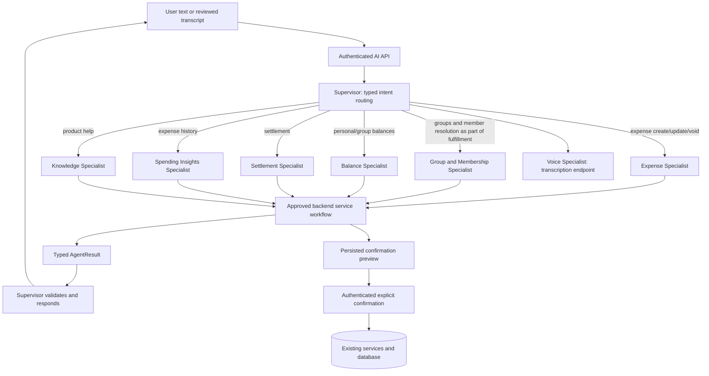

# SplitMate AI Architecture

## Current implementation

`POST /api/v1/ai/chat` authenticates the user before invoking LangGraph. Conversations and recent messages are persisted per user. The graph resolves the signed-in profile, asks the configured Ollama model for a typed intent, routes to one specialist, extracts typed arguments, runs the existing authorization-scoped backend workflow, and validates the specialist result before returning one SplitMate response. Voice transcription uses local Faster Whisper and sends its editable transcript through the same chat path.

The original business implementation remains in `backend/app/services/ai.py`. Expense splitting, balances, membership checks, settlement outstanding amounts, pending previews, service mutations, and help retrieval remain backend owned. Model output never supplies authenticated identity or database commands.

## Supervisor architecture

Routing is deterministic after typed intent classification; specialist agents cannot delegate to each other. Each chat turn makes one bounded specialist handoff. Unsupported and clarification intents remain with the Supervisor. The group/member persona owns membership resolution rules used by the existing fulfillment workflow; membership is checked by backend code, and participants must be registered active members. Knowledge retrieval only uses allowlisted product documentation.

## Personas, responsibilities, and approved capabilities

Persona definitions are in `AGENT_PERSONAS` in `backend/app/services/ai.py`. They specify professional identity, expertise, responsibility, instructions, approved capability names, inputs, outputs, limits, escalation, and error behavior. These are internal specialist roles; users continue to see one SplitMate AI voice.

| Agent | Routed work | Approved backend capability |
|---|---|---|
| Supervisor / SplitMate AI Orchestrator | Intent classification, bounded routing, response validation | `route_specialist`, `validate_agent_result` |
| Expense Specialist | Expense create, update, void | `prepare_expense_preview` |
| Group and Membership Specialist | Group/member resolution during fulfillment | `resolve_authorized_group`, `resolve_group_members` |
| Balance Specialist | Personal and group balances | `get_personal_balances`, `get_group_balances` |
| Settlement Specialist | Settlement preview | `prepare_settlement_preview` |
| Spending Insights Specialist | Recent expense history | `get_expense_history` |
| Product Help Specialist | Documentation questions | `retrieve_help_documents` |
| Voice Input Specialist | Audio transcription | `transcribe_audio` |

The capabilities above name the existing service operations; there is no arbitrary SQL, filesystem, or code execution tool. All operations use the authenticated request context and existing backend authorization. Live balances and monetary values come from backend services and queries, never from LLM arithmetic.

For expense creation, a typed `participant_mode` distinguishes explicit participants, all active members, and all members except named users. The backend also recognizes all-member wording from the original user message as a deterministic fallback if extraction omits that field. It then queries active memberships for the resolved caller-owned group and resolves names to registered users. An omitted participant list defaults to all active group members unless the text signals a restricted set such as “only”, “except”, or “selected”. Omitted payer defaults to the authenticated user unless the request says another person paid. The expense description defaults to “Group expense” when absent.

## Handoff contract and state

`AgentTask` and `AgentResult` are strict Pydantic schemas (`extra="forbid"`). A task carries the selected agent, typed intent, current user text, and only the small clarification/history metadata needed by the task. A result carries success, result data, clarification/completion flags, error code, optional recommendation, and tool result metadata. The Supervisor validates the result and requires a string message before returning it. Malformed results and specialist errors produce safe responses without exposing exception details.

Conversation ownership is enforced in the API. Recent history and the persisted clarification draft are passed to the graph; pending actions remain separate, user-owned records. The frontend can correct a transcript before chat submission. Voice transcription itself never executes a business action.

## Tool and confirmation flow

Read capabilities query only active groups/memberships belonging to the authenticated user. All writes are converted into server-calculated previews saved as `AIPendingAction` records with unique idempotency keys and a ten-minute expiry. The exact serialized parameters define the action; a user must explicitly confirm the action ID. Confirmation rechecks ownership, membership, permissions, expiry, group membership, and service constraints. Expense and settlement services remain the source of truth. Repeated confirmation returns the stored result instead of creating another record. Cancellation is owner-scoped.

Settlement direction and outstanding debt are backend-validated, and received settlements retain the existing recipient confirmation behavior. Updates and voids retain creator/admin authorization and existing financial history behavior. A changed request produces a new preview/action; it does not mutate a previously confirmed action.

## Errors, limits, and edge cases

- Wrong or unsupported routing is bounded to one specialist; output is validated and safe fallback text is returned on specialist failure.
- Missing fields and ambiguous groups/members return clarification options; the existing persisted draft supports multi-turn clarification.
- Nonmembers, inactive members, unauthorized users, and unregistered participants are rejected by backend membership checks.
- Tool/service validation errors do not execute an unconfirmed mutation; confirmation failures are returned as conflicts.
- Pending actions are owner scoped, expire, and are idempotent. Duplicate confirms return the prior result.
- User text and retrieved documents are treated as untrusted. Model generated user IDs are not accepted.
- Ollama failure is surfaced as an unavailable response by the API; Whisper failure is reported separately by the transcription endpoint.
- Voice amounts and names remain user-reviewable text and are parsed by the same chat workflow.

The current router handles one intent per turn. Combined requests containing multiple independent intents are not yet decomposed automatically; ask for one operation at a time. Handoff count is therefore capped at one, while LangGraph's fixed linear path and configured model timeout/retry settings bound execution. The existing settings are `AI_TIMEOUT_SECONDS` and `AI_MAX_RETRIES`; Ollama remains selected through `AI_PROVIDER`, `OLLAMA_BASE_URL`, and `OLLAMA_MODEL`.

The current expense schema supports equal, exact amount, and percentage splits. Multiple payers, group management intents, settlement history/details, arbitrary currency conversion, and explicit corrections to an already-previewed action are not implemented in the chat workflow. The product expense API currently supports INR only. Group resolution safely favors normalized exact matches, unique partial matches, then a high-confidence unique fuzzy match; otherwise it returns choices.

## Testing

Deterministic tests cover agent routing metadata, strict task/result validation, ambiguous group/member resolution, the all-active-members regression with mocked structured Ollama output, authenticated confirmation, duplicate execution, cancellation, and the existing expense workflow. Run `python -m pytest backend/tests -q` from the project root and `npm test` from `frontend`. Integration against a real Ollama server depends on that configured local service and model being available.

## API integration

Existing endpoints and frontend contract remain: `/api/v1/ai/chat`, `/api/v1/ai/status`, `/api/v1/ai/voice/transcribe`, conversation history endpoints, and explicit pending-action confirm/cancel endpoints. No provider or model change is required.
